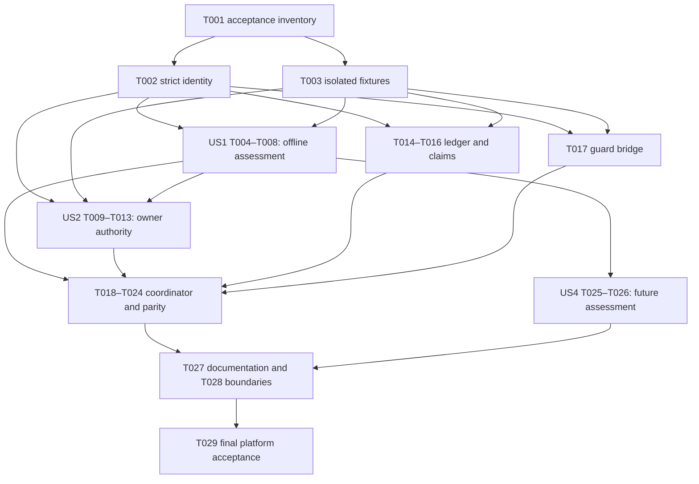

# Tasks: Optional provider-aware development orchestration

**Input**: [spec.md](spec.md), [plan.md](plan.md), [research.md](research.md),
[data-model.md](data-model.md), [CLI/host contract](contracts/cli-and-host.md) and [quickstart.md](quickstart.md).
**Accepted design baseline**: `362fd864e126b33fd793b3013d566f27c3cce176` (owner-merged PR #60).
**Status**: Generated tasks only; all work below is pending. Owner requested generation, not implementation or dispatch.

**Tests**: Required by SC-001–SC-006. Each code task writes its named regression cases first and implements the bounded
behavior in the same task. Initial RED is development evidence only: final task acceptance requires every named case
PASS, no skips/errors/unexpected outcomes, and inherited regressions unchanged. No expected-red CI exemption is granted.
A successor requires independently reviewed prerequisite evidence for the actual predecessor revision, not a checkbox.

## Format and execution contract

Every task uses `- [ ] Tnnn [P?] [USn?] description with exact paths`. [P] means file-disjoint work can proceed once all
listed prerequisites pass review; it never overrides dependencies or permits concurrent edits to a shared file.

Each task's allowed paths are exactly its listed implementation/document and test files, plus its own checkbox and
appended revision-bound evidence in this tasks.md. No other task marker or semantic requirement may change. Fixtures
modify disposable repositories only. Features 001–004 and existing guard/automation modules are protected. Scope or
contract changes require review and renewed affected approval; pure progress updates do not supply execution authority.

Use explicit reviewed source/tool pins and a per-task branch/context before execution; this generated list supplies no
runtime pin, owner grant, provider permission or live authority. No prerequisite task runs automatically.

### Test selector and command convention

For code task Tnnn, add unittest class `TnnnTests` in the test file shown below. The exact required methods are listed
in the acceptance table. Each ID is FILE_STEM.TnnnTests.test_METHOD; subtests must enumerate all relevant model
constraints/negative variants. Run `python3 -I -B scripts/TEST_FILE.py TnnnTests -v` with a host-approved supported
Python 3.11+ interpreter. Each script bootstraps trusted adjacent imports and ends in unittest.main().
Proposed per-check deadlines: 180 seconds per focused task class, 1,800 seconds for T024's full inherited matrix;
approve them in the execution context before running. Existing task-specific deadlines remain unchanged; repository
raw/qualified aggregate budgets remain 600/1,200 seconds. Any inability to meet them needs diagnosis and owner review,
not a skip, reduced assertions or silent budget increase. All final tasks also require repository validation and
`git diff --check`; run full `make check` at coherent integration checkpoints and before PR handoff in a pristine
committed checkout. T029's outer full-check budget is 2,100 seconds, separate from its unchanged nested budgets.

Documentation tasks T001/T026/T027 require `python3 -B scripts/check_repo.py` and `git diff --check`, plus independent
review against their listed deliverables. T029 has the combined commands specified in the final acceptance section.
New paths in task descriptions are future deliverables, not currently runnable scripts or existing evidence.

## Phase 1: Setup (Shared Infrastructure)

**Goal**: Freeze reviewable acceptance inputs before implementation.
**Independent test/checkpoint**: The inventory identifies exact baseline case IDs, commands, constraints and protected paths without authorizing execution.

- [ ] T001 Freeze the offline fixture/acceptance inventory, canonical identity vectors and inherited guard-case IDs at the accepted execution revision; record applicable/excluded cases with reasons, exact selectors, expected PASS outcomes, finite check deadlines and protected-tree identities. Do not grant dispatch or change existing check budgets. Deliver in `specs/005-provider-aware-orchestration/contracts/task-acceptance.md`.

## Phase 2: Foundational (Blocking Prerequisites)

**Goal**: Provide strict shared identity primitives and isolated synthetic fixtures.
**Independent test/checkpoint**: T002/T003 classes pass; fixture authorities cannot escape into live workflows. Both tasks block story work.

- [ ] T002 [P] Implement shared parsing and digest primitives: "UTF-8, unique keys, no unknown fields, no floats/non-finite values", "UTC integer timestamps", "1 MiB", "100 profiles", "100 evidence references per record" and canonical SHA-256 JSON. Reject unsafe artifact paths; IDs use bounded ASCII identifiers (1–128 characters, ASCII letters/digits plus . _ : -; no slash for individual IDs). Add trusted adjacent-module test bootstrapping without importing repository-selected plugins. Deliver in `scripts/provider_profiles.py` and `scripts/test_provider_profiles.py`.
- [ ] T003 [P] Create reusable disposable Git repositories, synthetic profile/owner/time/claim/runtime ports and fault hooks. Separate synthetic repository/state roots from the real checkout, isolate HOME/environment, refuse live ports and fail on attempted provider/network access. Tests must demonstrate fixture confinement rather than merely assert a fixture flag. Deliver in `scripts/test_profile_fixtures.py`.

## Phase 3: User Story 1 — Assess exact profile compatibility (P1, MVP)

**Goal**: Expose separate policy, capability and owner-authorization decisions with no remote access.
**Independent test/checkpoint**: T004–T008 classes cover three candidate families, unsupported combinations, stale/unknown evidence and truthful assess output.

- [ ] T004 [US1] Validate ExecutionProfile fields exactly as listed in data-model.md; secret_ref is "nullable" and host-opaque, with "no arbitrary file, environment variable or command" selection. Preserve separate native-interactive/direct-headless/orchestrated modes and task modes; "wildcard or version-range support is rejected". Represent Codex, Claude Code and Antigravity as unknown/unverified/disabled candidates, without inferred support. Deliver in `scripts/provider_profiles.py` and `scripts/test_provider_profiles.py`.
- [ ] T005 [US1] Validate PolicyEvidence fields and identity basis excluding evidence digests; enforce "reviewed_at", "review_due_at", "permitted/prohibited/unknown" and a strictly increasing finite review interval. Assess exact service/agreement/actions, primary-source revision references and trusted reviewer observations; conflicting, stale, inaccessible-at-renewal or insufficient evidence becomes unknown. Repository assertions alone never authenticate evidence. Deliver in `scripts/provider_profiles.py` and `scripts/test_provider_profiles.py`.
- [ ] T006 [US1] Validate CapabilityEvidence fields, exact implementation/action/outcome bindings and "provenance (offline/live)"; preserve verified/unverified/failed per action. "Offline provenance can verify local guard/fixture behavior only"; reject using it as actual-provider proof or inferring compatibility from an executable/credential. Trust comes only from host-injected observations, not submitted evidence JSON. Deliver in `scripts/provider_profiles.py` and `scripts/test_provider_profiles.py`.
- [ ] T007 [US1] Implement pure Assessment with separate permission, capability and authorization, precise safe blockers and remediation. Exact permitted + verified + active permits only the assessed action and profile; unknown combinations and any failed axis block. Profile preview cannot assert task eligibility and must perform zero credential reads, provider/tracker calls or mutations. Deliver in `scripts/provider_profiles.py` and `scripts/test_provider_profiles.py`.
- [ ] T008 [US1] Expose only assess and its sanitized JSON envelope/exit semantics from contracts/cli-and-host.md; assessment exit 0 is not eligibility. Default authorities are unavailable, malformed input exits 2 and opaque secret references never become logged credential values. Do not add guard/transfer/provider execution yet. Deliver in `scripts/profile_execution.py` and `scripts/test_profile_execution.py`.

## Phase 4: User Story 2 — Authorize and revoke a bounded profile (P1)

**Goal**: Bind attributable owner opt-in and finite validity to exact profile/evidence/action identity.
**Independent test/checkpoint**: T009–T013 classes reject absent/forged/cross-project/expired/revoked/drifted grants; authorized inspection and safe-stop remain distinct.

- [ ] T009 [P] [US2] Define trusted ProfileAuthority observation/verification ports pinned by host construction, with unavailable defaults and synthetic test authority only. Authenticate project owner, policy/capability reviewer and exact decision target independently; --approve, labels, owner_ref JSON, agent output and installation cannot grant authority. Existing task approval remains a separate required input. Deliver in `scripts/profile_authority.py` and `scripts/test_profile_authority.py`.
- [ ] T010 [US2] Implement trusted UTC time and reviewer-validity observation handling. Enforce "missing clock authority or observed clock rollback" rejection, finite owner-approved review/grant intervals and inclusive start/exclusive expiry boundaries. Never discover authority or renew permission through web/network access from profile input. Deliver in `scripts/profile_authority.py` and `scripts/test_profile_authority.py`.
- [ ] T011 [US2] Validate all ProfileAuthorization fields and "issued_at < expires_at, now within validity, unrevoked state and exact bindings". Bind project, profile/evidence digests, mode, allowed actions and attributable owner decision; changed profile/evidence requires a new grant. Profile authorization cannot supply task, rework, review, publication, merge or live approval. Deliver in `scripts/profile_authority.py` and `scripts/test_profile_authority.py`.
- [ ] T012 [US2] Return action-specific decisions after expiry/revocation: authorized inspection/evidence retention remains possible, while new implementation, provider execution and publication block. Safe-stop needs separately reviewed capability/authorization; uncertain remote cancellation remains a blocker and is never reported as immediate termination. Deliver in `scripts/profile_authority.py` and `scripts/test_profile_authority.py`.
- [ ] T013 [US2] Compose immutable assessment/grant bindings into a host revalidation operation for entry, resume, provider execution and handoff; reobserve time/revocation/evidence immediately before the protected action. Inject changes between initial assessment and invocation, and prove no protected callback follows a failed gate. Integration with real coordinator actions follows T018/T019. Deliver in `scripts/profile_authority.py` and `scripts/test_profile_authority.py`.

## Phase 5: User Story 3 — Equivalent guarded manual/orchestrated tasks (P1)

**Goal**: Reuse existing guards under durable claims, preserve recovery and block unsupported ownership transfers.
**Independent test/checkpoint**: T014–T024 classes prove normal/interrupted/rework parity, inherited negatives, crash reconciliation, one effective executor and no duplicate fixture publication.

- [ ] T014 [P] [US3] Implement host-owned local SQLite ledger and stable lock files: "outside the repository", owner-only modes, "SQLite FULL synchronous transactions", reject symlinks/unexpected owners/hardlinks/nonregular files and unsupported filesystems. Enforce "1,000 retained events per task before explicit archival" without truncation; database bound is 16 MiB. Storage uncertainty blocks mutations and retains evidence; do not modify existing stores. Deliver in `scripts/profile_state.py` and `scripts/test_profile_state.py`.
- [ ] T015 [US3] Implement TaskClaim key repository + feature + task_id, immutable executor/host/worktree/attempt bindings and "generation (strictly increasing)". Serialize competing executors with never-unlinked per-task locks; order coordinator lock before guard/handoff lock and use short SQLite transactions outside subprocess work. Stale generations conflict, and expiry/death alone never steals a claim. Deliver in `scripts/profile_state.py` and `scripts/test_profile_state.py`.
- [ ] T016 [US3] Journal operation identities and unclaimed/claimed/action-prepared/action-confirmed/reconcile-required/handoff-only/finished transitions. Persist intent before actions and confirmed results afterward; crash recovery must inspect existing guard attempt/commit/handoff identities rather than blindly repeat begin/publication. Fault-inject before/after durable writes and preserve state on uncertainty. Deliver in `scripts/profile_state.py` and `scripts/test_profile_state.py`.
- [ ] T017 [P] [US3] Implement a trusted revision-pinned subprocess bridge for existing begin/inspect/verify/complete/record-commit/resume/rework/status operations. Use literal argv, approved cwd, explicit supported interpreter, secret-free environment and finite approved deadlines; validate one JSON response, preserve raw exit and map failures per contract. Never duplicate scope/recovery logic or alter existing guard source/schema. Deliver in `scripts/profile_guard.py` and `scripts/test_profile_guard.py`.
- [ ] T018 [US3] Coordinate one manual guard operation under profile/task/claim revalidation and durable intent/result rules. Enforce exact task/source/prerequisite/scope/review/rework inputs and all protected boundaries; absent mutation authority blocks. Local synthetic completion must work without Symphony, live tracker, credentials or provider contact; external handoff remains explicitly incomplete when unavailable. Deliver in `scripts/profile_execution.py` and `scripts/test_profile_execution.py`.
- [ ] T019 [US3] Add host-injected orchestration delegation to unchanged Feature 004 assessment/handoff interfaces. Expose only demonstrated local GuardPort capabilities; preserve required runtime/tracker/source/owner observations and conditional safe-label rules. Missing ports block affected actions; no config-selected adapters, live provider transport or stock GitHub write fallback is allowed. Deliver in `scripts/profile_execution.py` and `scripts/test_profile_execution.py`.
- [ ] T020 [US3] Coordinate transfer-prepared/transferred/reconcile-required using expected generation, old-executor cessation/fencing evidence, new-profile/task revalidation and downstream constraints. Test a valid same-owner route change; reject ambiguous cessation, multi-host claims without authority and changed Feature 004 owners lacking a transfer API. Never edit downstream owner records, reset attempts or reuse another profile grant. Deliver in `scripts/profile_execution.py` and `scripts/test_profile_execution.py`.
- [ ] T021 [US3] Complete resume/rework coordination: retain implement/handoff-only/owner-authorized rework modes, immutable commit and publication identities, linked authorized successor attempts and fresh review/acceptance. Recover interrupted entry/completion/commit/publication from existing records; mismatches or uncertain writes block without duplicate implementation or blind retries. Deliver in `scripts/profile_execution.py` and `scripts/test_profile_execution.py`.
- [ ] T022 [US3] Expose status, guard, transfer and exercise CLI commands exactly per contract, including authorized read-only inspection of revoked state and unavailable-host defaults. Exercise accepts only disposable synthetic fixture roots and refuses real repositories/live ports; isolate HOME/environment and preserve sanitized provenance/raw exits without granting real execution authority. Deliver in `scripts/profile_execution.py` and `scripts/test_profile_execution.py`.
- [ ] T023 [US3] Run normal completion, interrupted handoff and authorized rework through both manual and synthetic orchestrated routes using the same approved task contexts. Require equal task guard outcomes, one retained implementation and one eventual fixture publication identity, current content-bound review and explicit offline provenance. Mutate synthetic task files only inside approved fixtures. Deliver in `scripts/test_profile_execution.py`.
- [ ] T024 [US3] Execute every applicable inherited negative case enumerated by T001 through both routes, including current/index/history/mode/scope/source/prerequisite/review/acceptance/recovery/rework. Add competing processes, revoked grants at boundaries and interrupted transfer/claim tests; prove zero protected side effects on failed gates and no duplicate publication. Missing inventory cases, skips/errors and unexpected passes fail acceptance. Deliver in `scripts/test_profile_execution.py`.

## Phase 6: User Story 4 — Assess future adapters without support claims (P2)

**Goal**: Make proposed API/cloud routes and missing evidence visible without implementing them.
**Independent test/checkpoint**: T025 passes; T026 contract review confirms no provider calls/adapters/activation and explicit proposal/offline/live distinctions.

- [ ] T025 [US4] Assess proposed future API/cloud adapter entries as incomplete until exact permission/capability/authorization evidence exists. Preserve proposal/offline/live distinctions and missing action-specific cancellation/recovery/fencing/publication capabilities. Do not implement adapters, load plugins, inspect credentials or treat an API/cloud authentication label as permission. Deliver in `scripts/provider_profiles.py` and `scripts/test_provider_profiles.py`.
- [ ] T026 [US4] Document the verified extension assessment examples and separately approved adapter boundary in contracts/cli-and-host.md, preserving identity, credential isolation, deadlines/cancellation, fencing, evidence, recovery and handoff requirements. Clearly label every proposed or unimplemented route and add no real-provider authorization or SDK/product dependency. Deliver in `specs/005-provider-aware-orchestration/contracts/cli-and-host.md`.

## Phase 7: Polish & Cross-Cutting Concerns

**Goal**: Complete truthful documentation, boundary regressions and platform evidence.
**Independent test/checkpoint**: All named cases and collected inherited cases pass; independent review and required CI support the exact candidate. Owner acceptance remains separate.

- [ ] T027 [P] Replace future-command placeholders in quickstart.md with actually implemented offline/manual commands, exact fixture selectors and observed limitations; document missing real-provider/owner-transfer/safe-label capabilities. Link revision-bound evidence without calling fixture success live verification, and retain separate owner merge/dispatch/activation gates. Deliver in `specs/005-provider-aware-orchestration/quickstart.md`.
- [ ] T028 [P] Verify Features 001–004 trees and existing guard/automation modules remain unchanged, product code has no AI dependency, and every new regression is collected by generic CI. Test secret-bearing malformed inputs/provider output never reach diagnostics, no runtime/queue is activated and no acceptance exemption is added. Deliver in `scripts/test_profile_execution.py`.
- [ ] T029 Run all five planned profile suites plus fixture self-tests, the exact inherited matrix, full make check and git diff --check on the accepted candidate using supported Python. Record matching macOS/Linux identities, raw outcomes/deadlines and SC-001–SC-006 evidence in acceptance.md; obtain independent exact-head review and publish a main-target PR. Keep completion unchecked for missing/failing evidence; do not merge or activate. Deliver in `specs/005-provider-aware-orchestration/acceptance.md`.

## Exact dependencies, allowed files and acceptance selectors

Descriptions above define the only writable files for their task (plus the progress-only exception stated earlier).
All listed test IDs are mandatory PASS outcomes; a test name groups the negative variants stated in its task, not
permission to omit them. T001 freezes detailed subcase IDs before implementation and its review must reject any gap
against the model/spec; T024 rejects missing, extra or skipped inherited cases rather than accepting a sample.

| Task | Prerequisites (accepted evidence) | Test file and required methods in TnnnTests |
| --- | --- | --- |
| T001 | None | Document/combined acceptance as specified above |
| T002 | T001 | `scripts/test_provider_profiles.py`: `test_strict_json`, `test_canonical_identity`, `test_input_limits` |
| T003 | T001 | `scripts/test_profile_fixtures.py`: `test_isolated_fixture`, `test_fixture_authority`, `test_no_live_ports` |
| T004 | T002, T003 | `scripts/test_provider_profiles.py`: `test_profile_fields`, `test_distinct_tuples`, `test_candidate_families` |
| T005 | T004 | `scripts/test_provider_profiles.py`: `test_policy_applicability`, `test_policy_expiry_conflict`, `test_policy_provenance` |
| T006 | T005 | `scripts/test_provider_profiles.py`: `test_capability_actions`, `test_offline_not_live`, `test_capability_revision` |
| T007 | T006 | `scripts/test_provider_profiles.py`: `test_three_axes`, `test_unlisted_blocked`, `test_assessment_no_calls` |
| T008 | T007 | `scripts/test_profile_execution.py`: `test_assess_cli`, `test_assess_untrusted_input`, `test_assess_envelope` |
| T009 | T002, T003 | `scripts/test_profile_authority.py`: `test_default_unavailable`, `test_authenticated_target`, `test_forged_owner` |
| T010 | T009 | `scripts/test_profile_authority.py`: `test_clock_unavailable`, `test_clock_rollback`, `test_review_validity` |
| T011 | T010 | `scripts/test_profile_authority.py`: `test_grant_exact_binding`, `test_grant_expiry_revoke`, `test_grant_not_task_approval` |
| T012 | T011 | `scripts/test_profile_authority.py`: `test_revoked_inspection`, `test_safe_stop_authority`, `test_cancellation_unknown` |
| T013 | T007, T012 | `scripts/test_profile_authority.py`: `test_boundary_revalidation`, `test_evidence_drift`, `test_cross_project_denied` |
| T014 | T002, T003 | `scripts/test_profile_state.py`: `test_private_state_root`, `test_storage_safety`, `test_durable_transaction` |
| T015 | T014 | `scripts/test_profile_state.py`: `test_single_claim`, `test_generation_cas`, `test_lock_order` |
| T016 | T015 | `scripts/test_profile_state.py`: `test_intent_before_action`, `test_reconcile_existing_attempt`, `test_persistence_uncertainty` |
| T017 | T002, T003 | `scripts/test_profile_guard.py`: `test_pinned_guard_invocation`, `test_guard_exit_mapping`, `test_guard_timeout_cleanup` |
| T018 | T008, T013, T016, T017 | `scripts/test_profile_execution.py`: `test_manual_local_guard`, `test_manual_gate_failure`, `test_manual_no_tracker` |
| T019 | T018 | `scripts/test_profile_execution.py`: `test_orchestration_delegation`, `test_unavailable_capability`, `test_safe_label_blocker` |
| T020 | T019 | `scripts/test_profile_execution.py`: `test_same_owner_transfer`, `test_stale_transfer`, `test_downstream_owner_blocked` |
| T021 | T020 | `scripts/test_profile_execution.py`: `test_handoff_only_resume`, `test_authorized_rework`, `test_uncertain_publication` |
| T022 | T021 | `scripts/test_profile_execution.py`: `test_status_authorized`, `test_exercise_confined`, `test_cli_failure_mapping` |
| T023 | T022 | `scripts/test_profile_execution.py`: `test_normal_parity`, `test_interrupted_parity`, `test_rework_parity` |
| T024 | T023 | `scripts/test_profile_execution.py`: `test_inherited_guard_negatives`, `test_competing_executor`, `test_revocation_race` |
| T025 | T007 | `scripts/test_provider_profiles.py`: `test_proposed_adapter_blocked`, `test_offline_adapter_blocked`, `test_no_adapter_loading` |
| T026 | T025 | Document/combined acceptance as specified above |
| T027 | T024, T026 | Document/combined acceptance as specified above |
| T028 | T024, T026 | `scripts/test_profile_execution.py`: `test_protected_trees`, `test_secret_redaction`, `test_generic_discovery` |
| T029 | T027, T028 | Document/combined acceptance as specified above |

## Dependencies & Execution Order



The table is authoritative at task granularity. US1 can be completed with synthetic/unavailable authorization
observations; actual protected actions remain blocked until US2 and US3 gates exist. US2 T009–T012 can be implemented
against fixtures independently while US1 progresses; T013 integrates with T007. US3 ledger and guard-bridge preparation
can proceed after the foundation, but the usable coordinator depends on completed US1/US2. US4 needs US1 assessment,
not live adapters or completion of every US3 action. Do not flatten these dependencies into one sequential queue.

## Parallel opportunities and examples per story

After T001 review, T002 and T003 are file-disjoint and can run together. Once both foundation tasks pass:

| Story | Safe parallel work (only after each prerequisite passes) | Shared-file restriction |
| --- | --- | --- |
| US1 | T004–T007 profile core alongside US2 T009–T012 authority and US3 T014–T016 ledger or T017 bridge | T008 assess CLI cannot overlap US3 coordinator edits to profile_execution.py. |
| US2 | T009–T012 authority alongside US1 profile core or US3 ledger/guard bridge | T013 waits for T007 and T012; no concurrent authority-file tasks. |
| US3 | T014–T016 ledger and T017 bridge can proceed together alongside US1/US2 | T018–T024 share coordinator/tests and remain ordered by the table. |
| US4 | T025–T026 alongside US3 coordinator after T007 review and after US1 T008 releases shared CLI use | T025 edits provider_profiles.py/test_provider_profiles.py; do not overlap US1 edits there. |

T027 documentation and T028 boundary tests are file-disjoint and may run together after T024 and T026 review.
[P] marks the clearest independent work lanes; the examples also allow ordered tasks within different lanes to proceed
concurrently. Stop and reconcile unexpected path overlap rather than widen scope or overwrite another task's evidence.

## Final acceptance and implementation strategy

MVP: T001–T008, demonstrating honest offline assessment with all mutation authorities unavailable. This does not
require opt-in execution or a live agent. Then add owner authority, durable claims/bridge and bounded synthetic route
parity, and finally extension-assessment documentation. Publish focused independently reviewed increments to main;
keep unresolved in-scope findings draft. No task here enables live Symphony, Claude/Antigravity adapters or Shiplight.

For T029 use the same supported interpreter and exact committed candidate on local macOS and clean Linux CI:

```sh
python3 -I -B scripts/test_provider_profiles.py -v
python3 -I -B scripts/test_profile_authority.py -v
python3 -I -B scripts/test_profile_state.py -v
python3 -I -B scripts/test_profile_guard.py -v
python3 -I -B scripts/test_profile_execution.py -v
python3 -I -B scripts/test_profile_fixtures.py -v
make check PYTHON=/absolute/path/to/supported/python3
git diff --check
```

All commands above are future execution commands until the relevant tasks implement their files. Apply the T001
reviewed case inventory, refuse empty/missing/extra/skipped/xfail/error or unexpected outcome collections, and retain
raw exits and provenance. Do not weaken existing negative tests or redefine expected behavior to obtain green CI.

| Acceptance | Primary task evidence |
| --- | --- |
| SC-001 explicit matrix/failed gates/no fallback | T004–T008, T009–T013, T025 |
| SC-002 three paired routes/one retained identity | T018–T023 |
| SC-003 all applicable inherited negatives | T001 inventory, T017 bridge, T024 sweep |
| SC-004 expiry/revocation/transfer/ownership | T010–T016, T020–T024 |
| SC-005 network-free guarded manual fixtures | T003, T018, T022–T023 |
| SC-006 extension and protected boundaries | T025–T029 |

Task completion needs bounded acceptance and independent review of its actual revision. Feature completion needs
T029's full evidence and owner acceptance. Issue export, queuing, profile grants, provider installation, merge and
live activation remain separately authorized actions; no unchecked task is automatically dispatchable.
